  

  
  
  
  

---

I like fine-tuning small models until they punch above their weight, and building the systems underneath them from scratch.

**Focus** &nbsp;·&nbsp; LLM fine-tuning, retrieval, systems in C++ 
**Stack** &nbsp;·&nbsp; Python, PyTorch, C++, FastAPI, JavaScript 
**Currently** &nbsp;·&nbsp; wrapping up Desi Agent, a 3B multilingual banking agent for the Lexsi AI hackathon 
**Rule of thumb** &nbsp;·&nbsp; if there's no benchmark, it doesn't count yet 
**Fun fact** &nbsp;·&nbsp; adult orcas have no natural predators

## Toolbox

  

  
  
  
  
  
  

| Area | What I reach for |
|---|---|
| **ML / LLMs** | PyTorch, Hugging Face Transformers, PEFT/QLoRA, SFT → GRPO, eval harnesses |
| **Backend** | FastAPI, MongoDB, ChromaDB, JWT auth, streaming responses |
| **Systems** | Modern C++ (C++23, `std::expected`, `std::span`), CMake, GoogleTest, Google Benchmark |
| **Frontend** | JavaScript, React, Vite, Tailwind |

---

## Featured work

### [VectorLite](https://github.com/ActiveMasquerade/mini_database): an embedded SQL database with vector search, from scratch
   

SQLite-style embedded engine (one library, one file, no server) where a `VECTOR(384)` column and a `WHERE author = 'Alice'` filter live in the **same query plan**. Relational predicates narrow the candidates before any distance math runs.

**~89 ms → ~0.3 ms** p50 vector search with HNSW · **recall@10 = 1.00** on a 10k × 384 corpus · WAL with redo/undo crash recovery

<b>Under the hood</b>

 

- A real B+Tree with split, merge, redistribution and root collapse, sitting on 4 KB pages behind an LRU buffer pool. Pages are read through `std::span` views and never copied on the hot path.
- `BEGIN` / `COMMIT` / `ROLLBACK` backed by a write-ahead log embedded in the database file.
- HNSW only becomes the default search path once its recall clears a fixed threshold against the exact-scan baseline.
- Property-based fuzzing of B+Tree invariants over randomized insert/delete sequences.
- Every public API returns `Result<T>` (`std::expected`), so no exception ever crosses a module boundary.

---

### [Constellation](https://github.com/ActiveMasquerade/RAG_personal): personal RAG with a built-in evaluation dashboard
    

Upload PDFs, Markdown and CSVs, then chat over them with citations, explore a similarity graph of your library, and **score your own retrieval**. The app writes golden questions from your chunks and runs them through the production pipeline (query rewrite → vector search → Cohere rerank).

**Hit rate 100% · MRR 1.00** on a 2,635-chunk technical corpus · **83.3%** on an adversarial set where two different PDFs share the same filename

---

### [fine-tuning-gemma](https://github.com/ActiveMasquerade/fine-tuning-gemma): Gemma 3 1B for legal reasoning
  

QLoRA fine-tune of a 1B instruct model on CaseHOLD (LexGLUE): pick the correct holding out of five candidates, on consumer and Colab-class GPUs.

**18.0% → 27.0% accuracy** (+50% relative) from 5,625 training examples with only LoRA adapters trained

---

### [Chip8++](https://github.com/ActiveMasquerade/chip8_emu): a deterministic CHIP-8 emulator
  

All **35 opcodes** follow the original COSMAC VIP behavior. The four ambiguous "quirk" instructions each get a documented default instead of whatever the last tutorial did. The core is headless with **zero SDL dependency**, so the full test suite runs anywhere, and SDL2 is just an optional frontend.

---

### [Desi Agent](https://github.com/CyberRik/desi-agent): multilingual banking agent *(with [@CyberRik](https://github.com/CyberRik))*
   

Lexsi AI Safety & Alignment Hackathon 2026, Track 3. A 3.35B Tiny Aya fine-tuned to call banking tools reliably in English, Hindi, Bengali, Hinglish and Banglish ("mera card block kar do"), and to **ask instead of guessing** when a detail is missing. Tool-call labels come from code rather than the teacher, so the 3B student ends up **beating its 14B teacher**. I owned the training and shipping lane.

**Task success 45.9% → 97.7%** on 486 held-out conversations · **wrong bank actions 20.8% → 1.8%** · two-step tasks 0% → 97.3% · 14B teacher: 67.5%
---

## Activity

  

